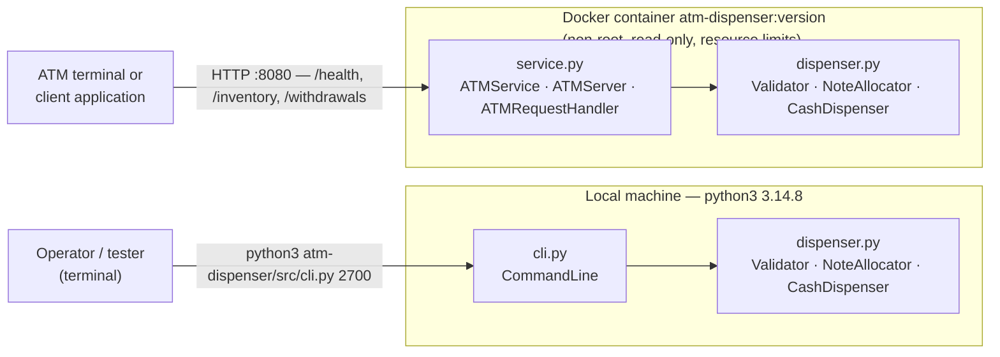
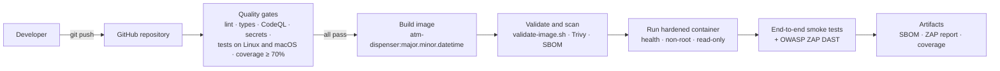
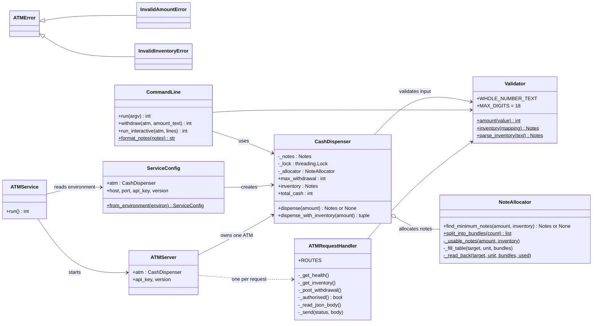
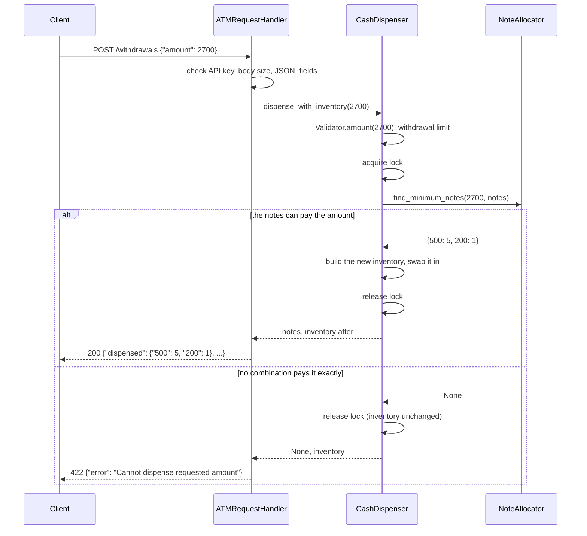

# ATM Cash Dispenser

[](https://github.com/AnupamGupta86/InmarCodingAssignment/actions/workflows/ci.yml)

1. [Introduction](#1-introduction)
2. [Assumptions](#2-assumptions)
3. [Architecture: high-level and low-level design](#3-architecture-high-level-and-low-level-design)
4. [Workflow](#4-workflow)
5. [Folder structure](#5-folder-structure)
6. [Setup and validation steps](#6-setup-and-validation-steps)
7. [Usage reference](#7-usage-reference)
8. [Validation rules and messages](#8-validation-rules-and-messages)
9. [Testing strategy](#9-testing-strategy)
10. [CI/CD and DevSecOps](#10-cicd-and-devsecops)
11. [Security](#11-security)
12. [Production considerations](#12-production-considerations)
13. [Requirements checklist](#13-requirements-checklist)

---

## 1. Introduction

**ATM Cash Dispenser** decides which notes an ATM should pay out for a withdrawal. It always uses
the **fewest possible notes**, only uses notes the machine actually holds, and updates its
inventory only when the whole amount can be paid. Several customers can withdraw at the same time
without ever being given the same notes.

```
ATM inventory: ₹500 × 8, ₹200 × 10, ₹100 × 20
Withdrawal ₹2700: ₹500 × 5, ₹200 × 1 (Total notes dispensed: 6)
Updated inventory: ₹500 × 3, ₹200 × 9, ₹100 × 20
```

Key features:

- **Correct, not just greedy:** finds the true minimum even where "biggest note first" fails
  (`{4: 1, 3: 2}` and ₹6 → `₹3 × 2`).
- **Any denominations:** nothing is hard-coded to ₹500/₹200/₹100.
- **Safe failures:** an amount that cannot be paid exactly gives *"Cannot dispense requested
  amount"* and leaves the inventory untouched; invalid input gets a clear message.
- **Thread-safe:** a lock makes "allocate notes → update inventory" one indivisible step.
- **Two ways to use it:** a **command-line program** and a **hardened HTTP/JSON service** (in Docker).
- **Small and object-oriented:** three source files, standard library only, Python 3.14.8.
- **Tested and shipped like production code:** 183 automated tests, a versioned and validated
  Docker image, and a DevSecOps pipeline for GitHub Actions and Azure DevOps.

**Quick start** (macOS/Linux with Python 3.14.8 and Docker; details in [section 6](#6-setup-and-validation-steps)):

```bash
git clone https://github.com/AnupamGupta86/InmarCodingAssignment.git && cd InmarCodingAssignment
python3 -m unittest discover -s atm-dispenser        # 183 tests
python3 atm-dispenser/src/cli.py 2700                # the brief's example
./scripts/run-container.sh                           # test, build, validate and run the service
```

---

## 2. Assumptions

- Amounts and denominations are whole numbers of the same currency unit (rupees).
- The output lists only denominations actually dispensed; the updated inventory lists all of them,
  including those at 0.
- The default inventory is the one from the brief, so `python3 atm-dispenser/src/cli.py 2700`
  reproduces the expected output directly.
- A single withdrawal is limited to 200,000 by default, as real ATMs limit withdrawals; it can be changed.
- An amount that cannot be paid with the notes available is a normal outcome, not an error: the
  CLI exits with code 1 and the service answers `422`. Invalid input is an error: exit code 2 / `400`.
- The inventory is in memory and resets when the program or service restarts (persistence is out of scope).
- Python is run as `python3` (macOS and Linux). Windows users run the Docker image (or use WSL),
  because `python3` is not guaranteed to exist on Windows.
- "Minimum notes" means the fewest notes in total, not the fewest denominations. When two
  combinations need the same number of notes, the one with higher-value notes is chosen, so the
  result is always the same for the same input.
- One running program or service is one ATM. The lock guarantees correct concurrent withdrawals
  inside that process; several processes sharing one stock need a database (see
  [Production considerations](#12-production-considerations)).
- Build times in versions are UTC.

---

## 3. Architecture: high-level and low-level design

### 3.1 High-level design (HLD)

**Components and where they run**



Both front ends are thin: every business rule lives once, in `dispenser.py`, so the command line
and the service always behave the same way.

**Build and delivery**



The same pipeline is defined for Azure DevOps in `azure-pipelines.yml`.

### 3.2 Low-level design (LLD)

**Classes** (three source files in `atm-dispenser/src/`)



| File | Classes | Responsibility |
|---|---|---|
| `dispenser.py` | `ATMError`, `InvalidAmountError`, `InvalidInventoryError`, `Validator`, `NoteAllocator`, `CashDispenser` | The business rules: validation, the minimum-notes algorithm, the inventory and its lock |
| `cli.py` | `CommandLine` | Arguments, output format, exit codes, interactive mode. No business rules. |
| `service.py` | `ServiceConfig`, `ATMService`, `ATMServer`, `ATMRequestHandler`, `JsonLogFormatter` | HTTP routing, request limits, API key, security headers, JSON logs, configuration, the OpenAPI contract. No business rules. |

**A withdrawal through the service**



Design decisions:

- **Separation of responsibilities.** `NoteAllocator` is a pure calculation, so it can be tested
  exhaustively on its own; `CashDispenser` only keeps the inventory consistent; the front ends
  only translate input and output.
- **Concurrency.** The lock covers reading the inventory, allocating and updating it. The new
  inventory is built as a complete copy and swapped in, so it is never half-updated.
- **Replaceable allocator.** `CashDispenser(..., allocator=...)` accepts another `NoteAllocator`;
  the concurrency tests use this to slow allocation down and prove the lock works.
- **One process = one ATM.** Several copies of the service would be several ATMs with separate
  notes; scaling out needs shared storage with row locking
  (see [Production considerations](#12-production-considerations)).

Alternatives considered:

| Option | Why it was not chosen |
|---|---|
| Greedy (biggest note first) | Fast, but wrong for some inventories (section 3.3.1) |
| Try every combination (brute force) | Always correct, but exponential; used only in the tests as an oracle |
| Integer linear programming solver | Correct and fast, but needs a third-party library (the brief allows the standard library only) |
| Web framework (Flask, FastAPI) | Adds dependencies to patch and scan; `http.server` with explicit limits is enough for three endpoints |
| A queue or a single worker thread instead of a lock | Also safe, but more moving parts for the same guarantee |

### 3.3 Algorithm: approach and complexity

#### 3.3.1 Why "biggest note first" (greedy) is not enough

| Inventory | Amount | Greedy | Correct |
|---|---|---|---|
| `{4: 1, 3: 2}` | 6 | 4, then 2 is impossible → **fails** | `3 × 2` |
| `{50: 1, 20: 3}` | 60 | 50, then 10 is impossible → **fails** | `20 × 3` |
| `{4: 10, 3: 10, 1: 10}` | 6 | 4 + 1 + 1 = 3 notes | `3 × 2` = 2 notes |

#### 3.3.2 Dynamic programming ("bounded coin change")

`NoteAllocator` builds a table that answers, for every amount from 0 to the target, *"what is the
fewest notes that make exactly this amount?"*. Every combination of the available notes is
considered, so the answer is always the true minimum, and "no answer" really means the amount
cannot be paid.

1. **Shrink the problem with the GCD.** Every payable amount is a multiple of the greatest
   common divisor of the denominations (100 for 500/200/100). So ₹2700 becomes 27 units, and
   ₹250 is rejected immediately.
2. **Only count useful notes.** No denomination can use more than `amount ÷ value` notes, so a
   machine reporting a trillion notes is no slower than one with just enough.
3. **Bundle the notes.** 8 notes of ₹500 become bundles of 1, 2, 4 and 1 notes. Any count from
   0 to 8 is a sum of some of these bundles, so the algorithm only decides "use this bundle or not".
4. **Add the bundles one at a time.** For each bundle and each amount, check whether
   "this bundle + the best way to make the rest" needs fewer notes than the best found so far.
5. **Read the answer back** by walking the bundles in reverse.

**Ties:** if two combinations use the same number of notes, the one with higher-value notes is
chosen (6 from `{4:1, 3:2, 2:1}` gives `4 + 2`), so results are always the same.

#### 3.3.3 Time and space complexity

Let **S** = amount ÷ GCD of the denominations, and **B** = number of bundles
(the sum over denominations of ⌈log₂(usable notes + 1)⌉).

| | Complexity | Notes |
|---|---|---|
| Time | **O(S × B)** | ₹2700 from the brief: S = 27, B = 13 → about 350 steps |
| Space | **O(S × B)** | one byte per (bundle, amount) to rebuild the answer, plus O(S) for the table |
| Inventory update | O(D) | D = number of denominations |

Measured: ₹199,990 from 7 denominations with up to 2,000 notes each takes about 0.1 s. Greedy is
O(D) but can be wrong; the textbook bounded version is O(S × total notes); bundling replaces
"total notes" with its logarithm.

---

## 4. Workflow

### 4.1 A withdrawal

1. **Validate the amount** before anything else, so bad input never touches the inventory.
2. **Lock** the ATM.
3. **Allocate**: find the fewest-note combination from the notes currently in the machine.
4. If none exists, **unlock** and report *"Cannot dispense requested amount"*: nothing was
   changed (requirements R5 and R6 in [section 13](#13-requirements-checklist)).
5. Otherwise build the **new inventory as a complete copy**, swap it in, **unlock** and return the
   notes (requirement R4).

### 4.2 Build, validate and run

The same order is used on a laptop (`scripts/run-container.sh`) and in CI. Nothing is built until
the tests pass, and nothing is run until the image is validated.

```
 tests ─▶ version ─▶ build image ─▶ validate image ─▶ start hardened container ─▶ health check
                     (major.minor.datetime)          ─▶ non-root & read-only checks ─▶ end-to-end smoke test
```

**Build version:** `major.minor.datetime`, for example `1.0.20261120183012`. Major and minor come
from `atm-dispenser/pyproject.toml`; the rest is the UTC build date and time
(`scripts/version.sh`). The version is the image tag and label, is set as `ATM_VERSION` in the
image, and is reported by `GET /health`, so the smoke test can confirm the running container is
exactly the image that was built.

---

## 5. Folder structure

```
InmarCodingAssignment/
├── atm-dispenser/                   the Python project
│   ├── src/
│   │   ├── dispenser.py             ATM core: Validator, NoteAllocator, CashDispenser, errors
│   │   ├── cli.py                   command line: CommandLine
│   │   └── service.py               HTTP/JSON service: ATMService, ATMServer, ATMRequestHandler
│   ├── tests/                       183 unittest tests
│   │   └── e2e/smoke_test.py        end-to-end test for a running service
│   ├── pyproject.toml               version, Python version and tool configuration
│   └── requirements-dev.txt         pinned dev tools (not needed at runtime)
├── scripts/
│   ├── run-container.sh             test, build, validate, start and check the container
│   ├── validate-image.sh            checks a built image before it is run
│   └── version.sh                   prints the build version (major.minor.datetime)
├── .github/workflows/ci.yml         CI/CD with DevSecOps gates (on every push and weekly)
├── azure-pipelines.yml              the same pipeline for Azure DevOps
├── Dockerfile                       runtime image (application code only)
└── Makefile                         shortcuts for the commands below
```

---

## 6. Setup and validation steps

All commands run from the repository root and use `python3`.

| Platform | How to run |
|---|---|
| macOS, Linux | `python3` 3.14.8 for the CLI and tests; Docker for the service |
| Windows | Docker (sections 6.4 and 7.2), or the macOS/Linux commands inside WSL |

### 6.1 Prerequisites

| Needed for | Tool | Check |
|---|---|---|
| Tests and CLI (6.2, 6.3) | Python 3.14.8 | `python3 --version` |
| Service in a container (6.4) | Docker | `docker version` |
| Optional dev checks (6.5) | ruff, mypy, coverage, pip-audit | `python3 -m pip install -r atm-dispenser/requirements-dev.txt` |

### 6.2 Get the code and run the tests

```bash
git clone https://github.com/AnupamGupta86/InmarCodingAssignment.git
cd InmarCodingAssignment
python3 -m unittest discover -s atm-dispenser -v        # expect: Ran 183 tests ... OK
```

Nothing to install and no `PYTHONPATH` to set: the scripts find their own modules, and the tests
add `src/` to the path themselves.

### 6.3 Validate the use cases with the command line

| # | Use case | Command | Expected result |
|---|---|---|---|
| 1 | Example from the brief | `python3 atm-dispenser/src/cli.py 2700` | `₹500 × 5, ₹200 × 1 (Total notes dispensed: 6)`; updated inventory `₹500 × 3, ₹200 × 9, ₹100 × 20`; exit code 0 |
| 2 | Greedy would fail | `python3 atm-dispenser/src/cli.py --inventory "4:1, 3:2" 6` | `₹3 × 2` |
| 3 | Limited notes | `python3 atm-dispenser/src/cli.py --inventory "500:2, 200:10, 100:20" 2400` | `₹500 × 2, ₹200 × 7` |
| 4 | Cannot dispense | `python3 atm-dispenser/src/cli.py 250` | `Cannot dispense requested amount`; `Inventory unchanged`; exit code 1 |
| 5 | More than the ATM holds | `python3 atm-dispenser/src/cli.py 9000` | `Cannot dispense requested amount`; exit code 1 |
| 6 | Several withdrawals in a row | `python3 atm-dispenser/src/cli.py 2700 2700 800` | the inventory goes down after each one |
| 7 | Zero / negative / text / decimal | `python3 atm-dispenser/src/cli.py 0`, `… -- -5`, `… abc`, `… 12.5` | clear error message; exit code 2 |
| 8 | Invalid inventory | `python3 atm-dispenser/src/cli.py --inventory "{}" 100`, `--inventory "500:-1"`, `--inventory "0:5"` | `empty`, `cannot be negative`, `Invalid denomination` |
| 9 | Above the withdrawal limit | `python3 atm-dispenser/src/cli.py --max-withdrawal 1000 2700` | `exceeds the limit of 1000`; exit code 2 |
| 10 | Interactive | `python3 atm-dispenser/src/cli.py`, then type amounts, `q` (or Ctrl+C) to quit | one result per line |

Check an exit code with `echo $?` straight after the command.

### 6.4 Build, validate and run the service in a container

One command does every step:

```bash
export ATM_API_KEY="$(python3 -c 'import secrets; print(secrets.token_urlsafe(32))')"   # optional
./scripts/run-container.sh          # or: make container
```

| Step | What it does | Pass condition |
|---|---|---|
| 1 | Runs the 183 unit, integration and security tests | `OK` (otherwise nothing is built) |
| 2 | Builds `atm-dispenser:<version>`, e.g. `atm-dispenser:1.0.20261120183012` | build succeeds |
| 3 | Validates the image (`scripts/validate-image.sh`) | version label and `ATM_VERSION` match; user 10001; health check defined; port 8080 exposed; `/app` holds only the application modules; no pip or setuptools; size ≤ 250 MB; the CLI inside dispenses the brief's example |
| 4 | Starts container `atm-dispenser` on `127.0.0.1:8080`: read-only filesystem, all capabilities dropped, `no-new-privileges`, 128 MB memory, 0.5 CPU, 100 processes | container running |
| 5 | Waits for the Docker health check (`GET /health`) | `healthy` within 30 s |
| 6 | Hardening checks inside the running container | runs as user 10001 (not root); writing a file fails |
| 7 | End-to-end smoke test with the API key | `All checks passed`, including "service reports version <version>" |

Then try the service:

```bash
export ATM_API_KEY="$(docker exec atm-dispenser printenv ATM_API_KEY)"
AUTH="Authorization: Bearer $ATM_API_KEY"; JSON="Content-Type: application/json"; URL=http://127.0.0.1:8080

curl -s $URL/health                                                     # shows the running version
curl -s -H "$AUTH" $URL/inventory
curl -s -H "$AUTH" -H "$JSON" -d '{"amount": 2700}' $URL/withdrawals   # 200: 500×5, 200×1
curl -s -H "$AUTH" -H "$JSON" -d '{"amount": 250}'  $URL/withdrawals   # 422: Cannot dispense requested amount
curl -s -H "$AUTH" -H "$JSON" -d '{"amount": 0}'    $URL/withdrawals   # 400: Amount must be greater than zero
curl -s -H "$JSON" -d '{"amount": 100}' $URL/withdrawals                # 401: no API key

docker logs -f atm-dispenser        # JSON request logs (Ctrl+C to stop following)
./scripts/run-container.sh --stop   # stop and remove the container (or: make container-stop)
```

**Windows (PowerShell) or any machine with only Docker:**

```bash
docker build -t atm-dispenser .
docker run --rm atm-dispenser python3 cli.py 2700                           # the CLI in the image
docker run -d --name atm-dispenser -p 127.0.0.1:8080:8080 --read-only --cap-drop ALL atm-dispenser
curl http://127.0.0.1:8080/health
docker rm -f atm-dispenser
```

### 6.5 Optional quality and security checks

```bash
python3 -m pip install -r atm-dispenser/requirements-dev.txt
make lint coverage security            # ruff (incl. security rules) + mypy, coverage ≥ 70 %, pip-audit
```

The image, Dockerfile, secret and DAST scans run in CI (see [CI/CD and DevSecOps](#10-cicd-and-devsecops)).

### 6.6 Troubleshooting

| Symptom | Fix |
|---|---|
| `python3: command not found` (Windows) | Use the Docker commands in 6.4, or WSL |
| `Address already in use` | Another process uses port 8080: `PORT=8081 ./scripts/run-container.sh`, or stop it (`lsof -i :8080`) |
| `401 Missing or invalid API key` | Send `Authorization: Bearer <key>` with the container's key (`docker exec atm-dispenser printenv ATM_API_KEY`) |
| `415 Content-Type must be application/json` | Add `-H 'Content-Type: application/json'` |
| Image validation fails | The failing check is printed; rebuild with `--build-arg VERSION=...` and check the Dockerfile |
| Container not `healthy` | `docker logs atm-dispenser`; check port 8080 is free; `docker inspect atm-dispenser` shows the health-check output |
| `Cannot connect to the Docker daemon` | Start Docker Desktop and try again |

---

## 7. Usage reference

### 7.1 Command line

| What | Command |
|---|---|
| One withdrawal (default inventory from the brief) | `python3 atm-dispenser/src/cli.py 2700` |
| Your own inventory | `python3 atm-dispenser/src/cli.py --inventory "500:8, 200:10, 100:20" 2700` |
| The brief's format also works | `python3 atm-dispenser/src/cli.py --inventory "{ 500: 8, 200: 10, 100: 20 }" 2700` |
| Several withdrawals on the same ATM, in order | `python3 atm-dispenser/src/cli.py 2700 2700 800` |
| Interactive mode (type amounts, `q` to quit) | `python3 atm-dispenser/src/cli.py` |
| A negative amount (`--` stops it being read as an option) | `python3 atm-dispenser/src/cli.py -- -5` |
| Change the per-withdrawal limit (default 200000) | `python3 atm-dispenser/src/cli.py --max-withdrawal 500000 300000` |
| Help | `python3 atm-dispenser/src/cli.py --help` |
| The same inside Docker | `docker run --rm atm-dispenser python3 cli.py 2700` |

**Exit codes** (with several amounts the worst one wins):

| Code | Meaning |
|---|---|
| `0` | Every withdrawal was dispensed |
| `1` | At least one amount could not be dispensed ("Cannot dispense requested amount") |
| `2` | Invalid input (amount, inventory or limit) |

### 7.2 HTTP service

The service runs in the Docker image (section 6.4).

| Method & path | Purpose | Responses |
|---|---|---|
| `GET /health` | Liveness probe and build version | `200 {"status": "ok", "version": "1.0.20261120183012"}` |
| `GET /inventory` | Notes in the ATM | `200 {"inventory": {"500": 8, …}, "total_cash": 8000}` |
| `POST /withdrawals` | Withdraw `{"amount": 2700}` | `200` dispensed · `400` invalid input · `422` cannot dispense · `401` no/invalid API key · `408` body too slow · `413` body > 1 KB · `415` not JSON |
| `GET /openapi.json` | OpenAPI 3 contract (used by the OWASP ZAP scan in CI) | `200` |

```bash
$ curl -s -H 'Content-Type: application/json' -d '{"amount": 2700}' localhost:8080/withdrawals
{"amount": 2700, "dispensed": {"500": 5, "200": 1}, "total_notes": 6, "inventory": {"500": 3, "200": 9, "100": 20}}

$ curl -s -H 'Content-Type: application/json' -d '{"amount": 250}' localhost:8080/withdrawals   # HTTP 422
{"error": "Cannot dispense requested amount", "amount": 250, "inventory": {"500": 3, "200": 9, "100": 20}}
```

JSON object keys are always text, so denominations appear as `"500"`. The `inventory` in each
response is the state right after that withdrawal, even when other customers withdraw at the same time.

Configuration (environment variables, e.g. `docker run -e ATM_INVENTORY="4:1, 3:2" ...`):

| Variable | Default | Meaning |
|---|---|---|
| `ATM_INVENTORY` | `500:8, 200:10, 100:20` | Notes in the ATM |
| `ATM_HOST` | `0.0.0.0` in the image | Listen address |
| `ATM_PORT` | `8080` | Listen port |
| `ATM_MAX_WITHDRAWAL` | `200000` | Largest amount per withdrawal (like a real ATM limit; also caps the work per request) |
| `ATM_API_KEY` | not set | If set (16+ chars), `/inventory` and `/withdrawals` need `Authorization: Bearer <key>` |
| `ATM_VERSION` | the build version | Version reported by `/health` |

Invalid configuration stops the service at start-up with a clear message (exit code 2). Logs are
one JSON object per line on stdout. `SIGTERM` (`docker stop`) shuts the service down cleanly.

### 7.3 Makefile shortcuts

| Target | Does |
|---|---|
| `make test` | all automated tests |
| `make version` | print the build version |
| `make docker-build` | tests, then build and validate the versioned image |
| `make container` / `make container-stop` | `scripts/run-container.sh` / stop it |
| `make smoke` | smoke test a running service (`URL=...`) |
| `make lint coverage security` | dev checks (need `requirements-dev.txt`) |

---

## 8. Validation rules and messages

| Input | Result |
|---|---|
| `0` | `Amount must be greater than zero` |
| `-500` | `Amount cannot be negative, got -500` |
| `"abc"`, `""`, `None`, `True`, `"2_700"`, `"१००"`, `"１００"` (non-ASCII digits) | `Amount must be a number, got …` |
| `12.5`, `"12.5"`, `2700.0` | `Amount must be a whole number, got …` |
| Text longer than 18 digits | `Amount is too large: at most 18 digits` |
| Above the per-withdrawal limit (default 200000) | `Amount … exceeds the limit of 200000 per withdrawal` |
| `{}` | `ATM inventory is empty: add at least one denomination` |
| `{500: -1}` | `… note count … cannot be negative` |
| `{500: 2.5}`, `{500: "8"}` | `… note count … must be a whole number` |
| `{0: 5}`, `{-100: 5}`, `{0.5: 5}`, `{"500": 5}` | `Invalid denomination … must be a positive whole number` |
| Amount that cannot be made exactly (e.g. 250) | `Cannot dispense requested amount` (CLI exit code 1, service `422`) |

Amount errors are `InvalidAmountError` and inventory errors `InvalidInventoryError`, both
subclasses of `ATMError`. Decisions worth calling out:

- Amounts may be whole numbers or whole-number text (`"2700"`, `" 2700 "`), as a keypad or command
  line produces. Floats are rejected even when whole (`2700.0`): money never passes through floating point.
- `True`/`False` are rejected although Python treats them as 1/0.
- Only the ASCII digits 0–9 count: Python itself would also accept Arabic-Indic, Devanagari or
  full-width digits, which no ATM keypad sends.
- A denomination with **0 notes is allowed** (an empty cassette); if every count is 0, every
  withdrawal gives "Cannot dispense".

---

## 9. Testing strategy

```bash
python3 -m unittest discover -s atm-dispenser -v                       # all 183 tests, about 6 seconds
python3 -m unittest discover -s atm-dispenser -p test_service.py       # one test file
python3 atm-dispenser/tests/e2e/smoke_test.py http://localhost:8080    # against a running service
```

| Type | Where | What it proves |
|---|---|---|
| **Unit** | `test_validation.py`, `test_allocator.py`, `test_dispenser.py` | Every rule of the brief: validation messages, minimum notes, limited notes, greedy traps, "cannot dispense", inventory updated only on success, withdrawal limit, inventory cannot be changed from outside |
| **Correctness oracle** | `test_allocator.AgainstBruteForceTests` | 400 random ATMs: the result always equals an exhaustive search of every combination |
| **Property / fuzz** | `test_fuzz.py` | Thousands of random and hostile inputs (unicode digits, NaN, huge numbers, random bytes): validation only returns clean values or our own error; invariants hold over random withdrawal sequences; the HTTP service never answers 500 |
| **Concurrency** | `test_concurrency.py`, `test_service.ConcurrentHttpTests` | 20 threads competing for 8 notes; a deliberately slowed `NoteAllocator` to force a race; a **control test proving the race happens without the lock**; 25 parallel HTTP withdrawals; each response reports the inventory right after its own withdrawal |
| **Integration (HTTP)** | `test_service.py` | A real server on a free port: every endpoint, status code and error path; keep-alive; malformed HTTP; slow (408) and cut-off (400) bodies; version in `/health`; start-up and clean shutdown on SIGTERM |
| **Security** | `test_service.SecurityTests`, `HttpProtocolTests` | API key (missing, wrong, wrong scheme), security headers, no version disclosure, no stack-trace leaks, request-id sanitising, body size/content-type limits, path traversal, logs without request bodies, a request hidden in a GET body cannot be smuggled through |
| **Configuration** | `test_service.ConfigTests` | Every environment variable, and that bad values stop the service from starting |
| **CLI** | `test_cli.py` | Output format, exit codes, withdrawal limit, interactive mode and Ctrl+C, `python3 atm-dispenser/src/cli.py` end to end |
| **Performance** | `test_allocator.PerformanceTests` | ₹199,990 from a large ATM in well under a second; a trillion notes per denomination is no slower |
| **Smoke-test script** | `test_smoke_script.py` | The e2e script passes against a healthy service, with and without an API key, checks the expected version, and fails clearly (not a crash) when the key is missing |
| **Image validation** | `scripts/validate-image.sh` | Version label and env, non-root user, health check, exposed port, only app code inside, no pip or setuptools, size limit, CLI works inside the image |
| **Container** | `scripts/run-container.sh`, CI | Health check passes, runs as non-root user 10001, filesystem is read-only |
| **End-to-end smoke** | `tests/e2e/smoke_test.py` | Against the running container: health and version, headers, withdraw, inventory change, failure leaves inventory unchanged, every validation error, 404/405/415, 401 without key |
| **DAST** | CI (OWASP ZAP) | Active scan of the running container, driven by `/openapi.json` |

---

## 10. CI/CD and DevSecOps

Every push runs `.github/workflows/ci.yml`; `azure-pipelines.yml` has the same stages for Azure DevOps.
Python is pinned to **3.14.8** everywhere: CI, Azure DevOps and the Docker base image.

```
 quality ─────────────────┐   ruff (incl. the Bandit security rules), mypy, pip-audit
 codeql                   │   CodeQL security analysis (security-extended queries)
 secrets                  │   gitleaks over the full git history
 test (Linux, macOS)      │   unit, integration, concurrency, fuzz, CLI
 coverage                 │   fails below 70 %
                          ▼   (the image is built only if all of the above pass)
 container            version (major.minor.datetime) → hadolint → build → validate image
                      → Trivy image CVEs → Trivy Dockerfile scan → SBOM
                      → start hardened container → health check → non-root & read-only checks
                      → smoke test (checks the version) → smoke test with API key → OWASP ZAP DAST
```

- **Versioning:** each run computes `major.minor.datetime` with `scripts/version.sh`, tags the
  image with it, shows it in the GitHub job summary, and sets it as the Azure DevOps build number.
  The SBOM artifact is named after the version.
- **Image validation** (`scripts/validate-image.sh`) runs before any scan or container start:
  version label and `ATM_VERSION`, user 10001, health check, port 8080, only the application modules in
  `/app`, no pip or setuptools, size ≤ 250 MB, and the CLI inside the image dispenses the brief's example.
- **Image patching:** the Dockerfile upgrades the OS packages at build time, so fixes released
  after the base image was published are included, and it removes pip and setuptools, which the
  app never uses. Trivy then fails the build on any remaining fixable HIGH or CRITICAL vulnerability.
- **Platforms:** tests run on Linux and macOS with `python3`; Windows is covered by the Docker image.
- The pipeline also runs every Monday, so newly published vulnerabilities in the code or the
  base image are found even without a push.

---

## 11. Security

### 11.1 Controls in this project

| Area | Control |
|---|---|
| Input | Every amount and inventory value validated; JSON only; body ≤ 1 KB; unknown fields rejected; numeric text ≤ 18 ASCII digits; per-withdrawal limit caps the work a request can cause |
| HTTP protocol | A body the server does not read closes the connection, so it can never be read as a hidden second request; slow bodies get 408, cut-off bodies 400 |
| Authentication | Optional bearer API key (`ATM_API_KEY`, ≥ 16 chars), compared in constant time; passed to the container from the environment, never stored in Git or written on a command line |
| Errors | No stack traces or internal details in responses; JSON errors for malformed HTTP too |
| HTTP headers | `nosniff`, `X-Frame-Options: DENY`, restrictive CSP, `no-referrer`, `no-store`; server software version hidden |
| Availability | Socket timeout against slow clients; connection backlog sized for bursts; CPU, memory and process limits on the container |
| Logging | Structured JSON logs; request bodies never logged; client request ids sanitised against log injection |
| Container | Slim base with OS packages patched at build time, no pip or setuptools (nothing to install at runtime), application code only, non-root UID 10001, read-only filesystem, all capabilities dropped, `no-new-privileges`, health check; validated before every run |
| Supply chain | Standard library only (no runtime dependencies), versioned images, SBOM per build, pinned tool versions |

### 11.2 Automated security checks (CI)

| Check | Tool | Fails the build on |
|---|---|---|
| Secret scanning (full history) | gitleaks | any secret |
| SAST | ruff `S` rules (the Bandit rule set), CodeQL (`security-extended`) | any finding |
| Dependency audit | pip-audit | known vulnerable version |
| Dockerfile lint | hadolint | warning or worse |
| Image validation | `scripts/validate-image.sh` | any failed check |
| Image CVEs | Trivy | fixable HIGH/CRITICAL |
| Dockerfile misconfiguration | Trivy config | HIGH/CRITICAL |
| Running container | health check, non-root and read-only checks, smoke tests | any failure |
| DAST against the running container | OWASP ZAP API scan (driven by `/openapi.json`) | report published as an artifact |

### 11.3 Reporting a vulnerability

Please open a private security advisory on the GitHub repository rather than a public issue.

---

## 12. Production considerations

Known limitations of this submission:

- The inventory is held in memory: it resets on restart, and there is no way to refill it while running.
- One process is one ATM; the service cannot be scaled out as it is (see the database options below).
- `http.server` handles one thread per connection; fine for one ATM, not for heavy traffic.
- No TLS in the container itself: it is expected behind an ingress or gateway that terminates TLS.

Already in place: API key, input and size limits, per-withdrawal limit, security headers, JSON
logs, health checks, graceful shutdown, versioned and validated images, and a hardened container.
Next steps for a real bank deployment:

- **TLS** at the ingress or API gateway, ideally mutual TLS between ATM terminals and the service
- **Identity:** replace the shared API key with OAuth2/OIDC or mTLS client certificates; keep secrets in Azure Key Vault
- **Rate limiting** per client at the gateway
- **Metrics** (Prometheus: withdrawals by result, latency, notes left per denomination) and alerts
- **Hosting:** push the versioned image to a registry (e.g. Azure Container Registry) and run it on a managed platform (e.g. Azure Container Apps or AKS) behind the gateway
- **Supply chain:** pin GitHub Actions and the base image by digest, sign images (cosign) and verify signatures before deploying

The lock protects one ATM inside one process, which is what this service is. A deployment where
several servers update the same stock needs the guarantee from shared storage:

- **Database transaction with a row lock** – `BEGIN; SELECT … FROM cassettes WHERE atm_id = ?
  FOR UPDATE;` allocate, `UPDATE` the counts, `COMMIT`. A failed allocation simply rolls back.
- **Optimistic locking** – keep a `version` column; `UPDATE … SET counts = ?, version = version + 1
  WHERE atm_id = ? AND version = ?`, and retry if no row was updated.
- **Database constraint** `CHECK (count >= 0)` as a last line of defence.
- **Dispense failures after allocation** (the hardware jams): reserve the notes first, then confirm
  or release them once the hardware reports what was actually paid out, and keep an audit log.
- **Idempotency key** per withdrawal request, so a retried request is not paid twice.

---

## 13. Requirements checklist

| # | Requirement from the brief | Where |
|---|---|---|
| R1 | Amount must be a positive whole number | `Validator.amount` |
| R2 | Only available notes / never more than available | `NoteAllocator` uses each note at most once; `test_allocator.NotesLimitTests` |
| R3 | Minimum number of notes | Dynamic programming; brute-force cross-check in `AgainstBruteForceTests` |
| R4 | Update inventory only after full allocation | `CashDispenser` builds the new inventory, then swaps it in |
| R5 | "Cannot dispense requested amount" | `CANNOT_DISPENSE`, printed by the CLI, returned by the service |
| R6 | Failed withdrawal leaves inventory unchanged | `test_dispenser.FailedWithdrawalTests` |
| R7 | Do not assume greedy | `{4:1, 3:2}` → `3 × 2`, tested |
| R8 | Any denominations | Nothing hard-coded; `test_other_denominations_are_supported` |
| R9 | Standard library only | `argparse`, `threading`, `http.server`, `json`, `math`, `functools`, `re`, `dataclasses`, `unittest` |
| R10 | Validation messages | [Section 8](#8-validation-rules-and-messages); `test_validation.py` |
| R11 | Concurrent withdrawals must not share notes | Lock in `CashDispenser`; `test_concurrency.py`, `ConcurrentHttpTests` |
| R12 | Positive and negative test cases | 183 tests ([section 9](#9-testing-strategy)); every validation error and every "cannot dispense" path |
| R13 | README: design, how to run and test, complexity | Sections [3](#3-architecture-high-level-and-low-level-design), [6](#6-setup-and-validation-steps), [9](#9-testing-strategy) and [3.3.3](#333-time-and-space-complexity) |
| R14 | Readable, maintainable code | Three small object-oriented modules with type hints; ruff and mypy checked in CI |
