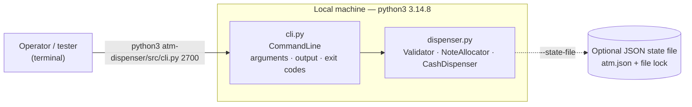
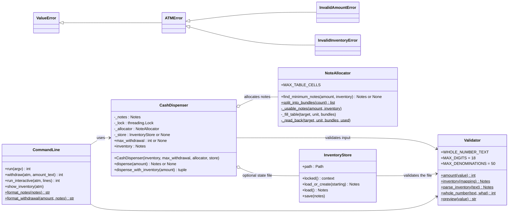
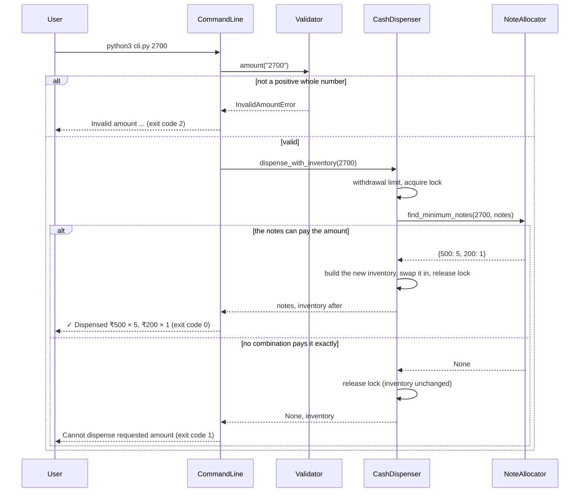
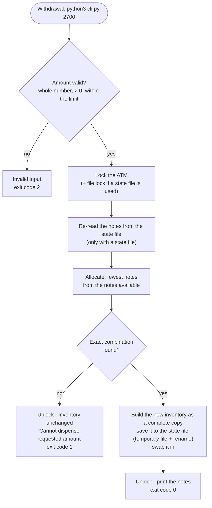
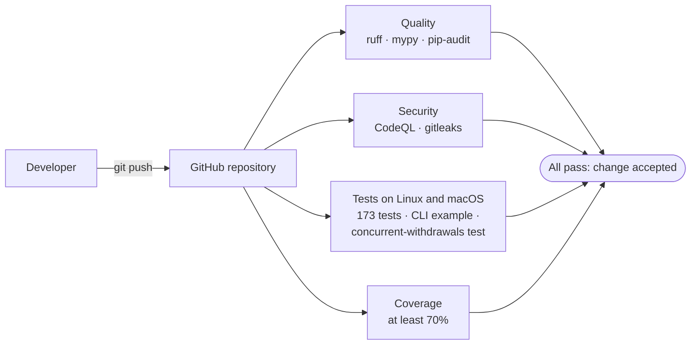

# ATM Cash Dispenser

[](https://github.com/AnupamGupta86/InmarCodingAssignment/actions/workflows/ci.yml)

1. [Overview & Assumptions](#1-overview--assumptions)
2. [Solution Architecture & Workflow](#2-solution-architecture--workflow)
3. [Project Structure](#3-project-structure)
4. [Requirements Coverage](#4-requirements-coverage)
5. [Installation, Configuration & Usage](#5-installation-configuration--usage)
6. [Validation & Testing Strategy](#6-validation--testing-strategy)
7. [Security & DevSecOps](#7-security--devsecops)
8. [Troubleshooting & FAQ](#8-troubleshooting--faq)

## 1. Overview & Assumptions

### 1.1 Introduction

**ATM Cash Dispenser** is a command-line program that decides which notes an ATM should pay out
for a withdrawal. It always uses the **fewest possible notes**, only uses notes the machine
actually holds, and updates its inventory only when the whole amount can be paid. Several
withdrawals at the same time never get the same notes.

```
$ python3 atm-dispenser/src/cli.py 2700 250
----------------------------------------------------------------------
ATM inventory:          ₹500 × 8, ₹200 × 10, ₹100 × 20  (total ₹8,000)
----------------------------------------------------------------------

Withdrawal ₹2,700
-----------------
  ✓ Dispensed:          ₹500 × 5, ₹200 × 1 (Total notes dispensed: 6)
  Updated inventory:    ₹500 × 3, ₹200 × 9, ₹100 × 20  (total ₹5,300)

Withdrawal ₹250
---------------
  ✗ Cannot dispense requested amount
  Inventory unchanged:  ₹500 × 3, ₹200 × 9, ₹100 × 20  (total ₹5,300)
```

The inventory is framed by dashed rules and each withdrawal is a block under its own
underlined heading: ✓ when it was paid, ✗ when it was not. Amounts use
Indian digit grouping (₹2,700, ₹2,00,000), and every inventory line shows its total.

Key features:

- **Correct, not just greedy:** finds the true minimum even where "biggest note first" fails
  (`{4: 1, 3: 2}` and ₹6 → `₹3 × 2`).
- **Any denominations:** nothing is hard-coded to ₹500/₹200/₹100.
- **Safe failures:** an amount that cannot be paid exactly gives *"Cannot dispense requested
  amount"* and leaves the inventory untouched; invalid input gets a clear message.
- **Thread-safe:** a lock makes "allocate notes → update inventory" one indivisible step.
- **Optional persistence:** the inventory can be kept in a JSON file that survives restarts and
  can be shared safely by several processes.
- **Small and object-oriented:** two source files, standard library only, Python 3.14.8.
- **Tested like production code:** 173 automated tests and a DevSecOps pipeline for GitHub
  Actions and Azure DevOps.

### 1.2 Assumptions

- Amounts and denominations are whole numbers of the same currency unit (rupees).
- The output lists only denominations actually dispensed; the updated inventory lists all of them,
  including those at 0.
- The default inventory is the one from the brief, so `python3 atm-dispenser/src/cli.py 2700`
  reproduces the expected output directly.
- A single withdrawal is limited to 200,000 by default, as real ATMs limit withdrawals. Change it
  with `--max-withdrawal`.
- An amount that cannot be paid with the notes available is a normal outcome, not an error: exit
  code 1. Invalid input is an error: exit code 2.
- The inventory is kept in memory by default and resets when the program ends. With
  `--state-file` it is saved as JSON after every withdrawal, survives restarts and can be shared
  by several processes. An existing state file wins over `--inventory`.
- Python **3.14.8** must be installed (`python3 --version`). On Windows, use WSL.
- "Minimum notes" means the fewest notes in total, not the fewest denominations. When two
  combinations need the same number of notes, the one with higher-value notes is chosen, so the
  result is always the same for the same input.
- One running program is one ATM. The in-process lock protects concurrent withdrawals inside it;
  several processes on one machine share one stock safely through the same state file (a file
  lock, proved by `scripts/test-concurrent-withdrawals.sh`). Several machines would need a shared
  database instead.

---

## 2. Solution Architecture & Workflow

### 2.1 High-Level Design (HLD)

**Components**



The command line is thin: every business rule lives once, in `dispenser.py`, and the CLI only
reads the input and prints the result.

### 2.2 Low-Level Design (LLD)

**Classes** (two source files in `atm-dispenser/src/`)



| File | Classes | Responsibility |
|---|---|---|
| `dispenser.py` | `ATMError`, `InvalidAmountError`, `InvalidInventoryError`, `Validator`, `NoteAllocator`, `InventoryStore`, `CashDispenser` | The business rules: validation, the minimum-notes algorithm, the optional JSON state file, the inventory and its lock |
| `cli.py` | `CommandLine` | Arguments, output format, exit codes, interactive mode (withdraw, `i` inventory, `q` quit). No business rules. |

**A withdrawal from the command line**



Design decisions:

- **Separation of responsibilities.** `NoteAllocator` is a pure calculation, so it can be tested
  exhaustively on its own; `CashDispenser` only keeps the inventory consistent; the CLI only
  translates input and output.
- **Concurrency.** The lock covers reading the inventory, allocating and updating it. The new
  inventory is built as a complete copy and swapped in, so it is never half-updated.
- **Replaceable allocator.** `CashDispenser(..., allocator=...)` accepts another `NoteAllocator`;
  the concurrency tests use this to slow allocation down and prove the lock works.
- **One process = one ATM, unless they share a state file.** Separate processes have separate
  notes; with one state file they take turns through its file lock and behave as one ATM
  (`scripts/test-concurrent-withdrawals.sh`).

Alternatives considered:

| Option | Why it was not chosen |
|---|---|
| Greedy (biggest note first) | Fast, but wrong for some inventories (section [2.3.1](#231-why-biggest-note-first-greedy-is-not-enough)) |
| Try every combination (brute force) | Always correct, but exponential; used only in the tests as an oracle |
| Integer linear programming solver | Correct and fast, but needs a third-party library (the brief allows the standard library only) |
| A queue or a single worker thread instead of a lock | Also safe, but more moving parts for the same guarantee |
| SQLite or another database for the state | Also standard library (SQLite), but a JSON file is readable by eye and the file lock is enough on one machine; a database is the step for several machines |

### 2.3 Algorithm: Approach And Complexity

#### 2.3.1 Why "Biggest Note First" (Greedy) Is Not Enough

| Inventory | Amount | Greedy | Correct |
|---|---|---|---|
| `{4: 1, 3: 2}` | 6 | 4, then 2 is impossible → **fails** | `3 × 2` |
| `{50: 1, 20: 3}` | 60 | 50, then 10 is impossible → **fails** | `20 × 3` |
| `{4: 10, 3: 10, 1: 10}` | 6 | 4 + 1 + 1 = 3 notes | `3 × 2` = 2 notes |

#### 2.3.2 Dynamic Programming ("Bounded Coin Change")

`NoteAllocator` builds a table that answers, for every amount from 0 to the target, *"what is the
fewest notes that make exactly this amount?"*. Every combination of the available notes is
considered, so the answer is always the true minimum, and "no answer" really means the amount
cannot be paid.

1. **Shrink the problem with the GCD (Greatest Common Divisor).** Every payable amount is a
   multiple of the greatest common divisor of the denominations (100 for 500/200/100). So ₹2700 becomes 27 units, and
   ₹250 is rejected immediately.
2. **Only count useful notes.** No denomination can use more than `amount ÷ value` notes, so a
   machine reporting a trillion notes is no slower than one with just enough.
3. **Bundle the notes.** 8 notes of ₹500 become bundles of 1, 2, 4 and 1 notes. Any count from
   0 to 8 is a sum of some of these bundles, so the algorithm only decides "use this bundle or not".
4. **Add the bundles one at a time.** For each bundle and each amount, check whether
   "this bundle + the best way to make the rest" needs fewer notes than the best found so far.
5. **Read the answer back** by walking the bundles in reverse.

**Ties:** if two combinations use the same number of notes, the one with higher-value notes is
chosen (6 from `{4:1, 3:2, 2:1}` gives `4 + 2`), so results are always the same.

#### 2.3.3 Time And Space Complexity

Let **S** = amount ÷ GCD (greatest common divisor) of the denominations, and **B** = number of bundles
(the sum over denominations of ⌈log₂(usable notes + 1)⌉).

| | Complexity | Notes |
|---|---|---|
| Time | **O(S × B)** | ₹2700 from the brief: S = 27, B = 12 → about 336 steps |
| Space | **O(S × B)** | one byte per (bundle, amount) to rebuild the answer, plus O(S) for the table |
| Inventory update | O(D) | D = number of denominations |

Measured: ₹199,990 from 7 denominations with up to 2,000 notes each takes about 0.1 s. Greedy is
O(D) but can be wrong; the textbook bounded version is O(S × total notes); bundling replaces
"total notes" with its logarithm.

### 2.4 Workflow: A Withdrawal



Invalid input never touches the inventory, a refused withdrawal changes nothing (requirements R5
and R6 in [section 4](#4-requirements-coverage)), and the inventory is updated only after the
whole amount is allocated (R4). If saving the state file fails, nothing changes.

### 2.5 Workflow: Continuous Integration

Every push runs the same checks on GitHub Actions (`.github/workflows/ci.yml`) and Azure DevOps
(`azure-pipelines.yml`). A change is accepted only when all of them pass.



---

## 3. Project Structure

```
InmarCodingAssignment/
├── atm-dispenser/                   the Python project
│   ├── src/
│   │   ├── dispenser.py             ATM core: Validator, NoteAllocator, InventoryStore, CashDispenser, errors
│   │   └── cli.py                   command line: CommandLine
│   ├── tests/                       173 unittest tests, one file per source file
│   │   ├── test_dispenser.py        validation, algorithm, ATM, state file, concurrency, property tests
│   │   └── test_cli.py              CommandLine
│   ├── pyproject.toml               version, Python version and tool configuration
│   └── requirements-dev.txt         pinned dev tools (not needed to run the program)
├── scripts/
│   └── test-concurrent-withdrawals.sh  several processes withdraw at the same time and never pay the same notes
├── .github/workflows/ci.yml         CI with DevSecOps gates (on every push and weekly)
├── azure-pipelines.yml              the same pipeline for Azure DevOps
└── Makefile                         shortcuts for the commands below
```

---

## 4. Requirements Coverage

| # | Requirement from the brief | Where |
|---|---|---|
| R1 | Amount must be a positive whole number | `Validator.amount` |
| R2 | Only available notes / never more than available | `NoteAllocator` uses each note at most once; `test_dispenser.NotesLimitTests` |
| R3 | Minimum number of notes | Dynamic programming; brute-force cross-check in `AgainstBruteForceTests` |
| R4 | Update inventory only after full allocation | `CashDispenser` builds the new inventory, then swaps it in |
| R5 | "Cannot dispense requested amount" | `CANNOT_DISPENSE`, printed by the CLI; `dispense()` returns `None` |
| R6 | Failed withdrawal leaves inventory unchanged | `test_dispenser.FailedWithdrawalTests` |
| R7 | Do not assume greedy | `{4:1, 3:2}` → `3 × 2`, tested |
| R8 | Any denominations | Nothing hard-coded; `test_other_denominations_are_supported` |
| R9 | Standard library only | No third-party packages (`dependencies = []`): `argparse`, `threading`, `fcntl`, `json`, `math`, `tempfile`, `unittest` and other built-in modules |
| R10 | Validation messages | [Section 6.1](#61-validation-rules-and-messages); `test_dispenser.InvalidAmountTests`, `InvalidInventoryTests` |
| R11 | Concurrent withdrawals must not share notes | Lock in `CashDispenser` (threads) and the state-file lock (processes); `test_dispenser.ConcurrentWithdrawalTests`, `StateFileTests`, `scripts/test-concurrent-withdrawals.sh` |
| R12 | Positive and negative test cases | 173 tests ([section 6.2](#62-testing-strategy)); every validation error and every "cannot dispense" path |
| R13 | README: design, how to run and test, complexity | Sections [2](#2-solution-architecture--workflow) (design and [complexity](#233-time-and-space-complexity)), [5](#5-installation-configuration--usage) (how to run) and [6.2](#62-testing-strategy) (tests) |
| R14 | Readable, maintainable code | Two small object-oriented modules with type hints; ruff and mypy checked in CI |

---

## 5. Installation, Configuration & Usage

> **macOS (zsh):** run `setopt interactivecomments` once (add it to `~/.zshrc` to keep it), so the
> `# comments` after the commands below are ignored when you paste them.

### 5.1 Installation

The only requirement is **Python 3.14.8** (`python3 --version`) on macOS or Linux; on Windows, use
WSL. Nothing else is installed: the program uses only the standard library, and no `PYTHONPATH`
needs to be set. All commands run from the repository root.

```bash
git clone https://github.com/AnupamGupta86/InmarCodingAssignment.git && cd InmarCodingAssignment
python3 -m unittest discover -s atm-dispenser        # check: Ran 173 tests ... OK
python3 atm-dispenser/src/cli.py 2700                # the example from the brief
```

### 5.2 Configuration

The ATM is configured with command-line options; there is no configuration file.

| Option | Default | Meaning |
|---|---|---|
| `--inventory "500:8, 200:10, 100:20"` | the brief's inventory | Notes in the ATM; the brief's format `"{ 500: 8, 200: 10, 100: 20 }"` also works |
| `--max-withdrawal 500000` | `200000` | Largest amount per withdrawal |
| `--state-file atm.json` | none (memory only) | Keep the inventory in a JSON file: it survives restarts and can be shared by several processes. The first line of the output says whether the file was created or its saved notes are used (they win over `--inventory`) |

### 5.3 Usage

```
python3 atm-dispenser/src/cli.py [options] [amounts ...]
```

- **With amounts**, each one is withdrawn in turn from the same ATM: `cli.py 2700 2700 800`.
- **Without amounts**, it starts **interactive mode**: type an amount at the `>` prompt, `i` to show
  the inventory and total cash, `h` for help, `q` (or Ctrl+C) to quit.
- A negative amount needs `--` first, so it is not read as an option: `cli.py -- -5`.
- `--help` shows the options, examples and exit codes.

**Exit codes** (check with `echo $?` straight after the command; with several amounts the worst wins):

| Code | Meaning |
|---|---|
| `0` | Every withdrawal was dispensed |
| `1` | At least one amount could not be dispensed ("Cannot dispense requested amount") |
| `2` | Invalid input (amount, inventory or limit), or a state file that cannot be read or saved |
| `130` | Cancelled with Ctrl+C |

### 5.4 Use Cases To Try

| # | Use case | Command | Expected result |
|---|---|---|---|
| 1 | Example from the brief | `python3 atm-dispenser/src/cli.py 2700` | `✓ Dispensed: ₹500 × 5, ₹200 × 1 (Total notes dispensed: 6)`; `Updated inventory: ₹500 × 3, ₹200 × 9, ₹100 × 20 (total ₹5,300)`; exit code 0 |
| 2 | Greedy would fail | `python3 atm-dispenser/src/cli.py --inventory "4:1, 3:2" 6` | `₹3 × 2` |
| 3 | Any denominations, not just ₹500/₹200/₹100 | `python3 atm-dispenser/src/cli.py --inventory "2000:2, 50:4, 7:3" 2064` | `₹2,000 × 1, ₹50 × 1, ₹7 × 2` |
| 4 | Limited notes | `python3 atm-dispenser/src/cli.py --inventory "500:2, 200:10, 100:20" 2400` | `₹500 × 2, ₹200 × 7` |
| 5 | Cannot dispense | `python3 atm-dispenser/src/cli.py 250` | `✗ Cannot dispense requested amount`; `Inventory unchanged: …`; exit code 1 |
| 6 | More than the ATM holds | `python3 atm-dispenser/src/cli.py 9000` | `Cannot dispense requested amount`; exit code 1 |
| 7 | Several withdrawals in a row | `python3 atm-dispenser/src/cli.py 2700 2700 800` | the inventory goes down after each one |
| 8 | Zero / negative / text / decimal | `python3 atm-dispenser/src/cli.py 0`, `… -- -5`, `… abc`, `… 12.5` | clear error message; exit code 2 |
| 9 | Invalid inventory | `python3 atm-dispenser/src/cli.py --inventory "{}" 100`, `--inventory "500:-1"`, `--inventory "0:5"` | `empty`, `cannot be negative`, `Invalid denomination` |
| 10 | Above the withdrawal limit | `python3 atm-dispenser/src/cli.py --max-withdrawal 1000 2700` | `exceeds the limit of 1000`; exit code 2 |
| 11 | Interactive session | `python3 atm-dispenser/src/cli.py`, then `2700`, `i`, `q` | one result block, then the inventory `₹500 × 3, ₹200 × 9, ₹100 × 20 (total ₹5,300)`, then `Goodbye.` |
| 12 | Inventory kept between runs | `python3 atm-dispenser/src/cli.py --state-file /tmp/atm.json 2700`, twice | the second run starts from `₹500 × 3, ₹200 × 9, ₹100 × 20`; delete `/tmp/atm.json` to start fresh |
| 13 | Several processes, one ATM | `./scripts/test-concurrent-withdrawals.sh` | exactly 4 of 10 customers paid, no note paid twice (details in [6.2](#62-testing-strategy)) |

### 5.5 Developer Tools

The lint, type, coverage and audit tools go in a virtual environment (Homebrew and recent Linux
Pythons refuse a system-wide `pip install` with `error: externally-managed-environment`):

```bash
python3 -m venv .venv && source .venv/bin/activate       # once; later just: source .venv/bin/activate
python3 -m pip install -r atm-dispenser/requirements-dev.txt
```

| Make target | Does |
|---|---|
| `make test` | All automated tests (no virtual environment needed) |
| `make concurrency-test` | Several processes withdraw at the same time ([6.2](#62-testing-strategy)) |
| `make lint coverage security` | ruff (including security rules) and mypy, coverage of at least 70%, pip-audit |
| `make dev-tools` | Checks the tools are installed in the active Python, and prints the setup steps if not |
| `make help` | Lists the targets |

CodeQL and the secret scan run in CI ([Security & DevSecOps](#7-security--devsecops)).

---

## 6. Validation & Testing Strategy

### 6.1 Validation Rules And Messages

| Input | Result |
|---|---|
| `0` | `Amount must be greater than zero` |
| `-500` | `Amount cannot be negative, got -500` |
| `"abc"`, `""`, `None`, `True`, `"2_700"`, `"१००"`, `"１００"` (non-ASCII digits) | `Amount must be a number, got …` |
| `12.5`, `"12.5"`, `2700.0` | `Amount must be a whole number, got …` |
| More than 18 digits | `Amount is too large: at most 18 digits` |
| Above the per-withdrawal limit (default 200000) | `Amount … exceeds the limit of 200000 per withdrawal` |
| `{}` | `ATM inventory is empty: add at least one denomination` |
| `{500: -1}` | `… note count … cannot be negative` |
| `{500: 2.5}`, `{500: "8"}` | `… note count … must be a whole number` |
| `{0: 5}`, `{-100: 5}`, `{0.5: 5}`, `{"500": 5}` | `Invalid denomination … must be a positive whole number` |
| More than 50 denominations | `Too many denominations: N (at most 50)` |
| An amount that would need more than 64 million calculation steps (only possible after raising the withdrawal limit, e.g. ₹10¹² in ₹1 notes) | `Amount … is too large to work out with this inventory; lower the amount or the withdrawal limit` |
| State file that is not valid JSON, has the wrong shape, bad values or the same denomination twice (`"500"` and `"0500"`) | `Cannot read the state file …` / `Invalid denomination … (in the state file …)`; exit code 2 |
| State file in a folder that does not exist or is not writable | `Cannot use the state file …`; exit code 2 |
| State file that is a device, a named pipe or larger than 1 MB (e.g. `--state-file /dev/zero`) | `Cannot read the state file …: it is not a regular file` / `it is too large`; refused before reading, exit code 2 |
| State file corrupted or deleted while the program is running | `Cannot read the state file …; nothing was dispensed`; exit code 2; the session carries on |
| State file can no longer be saved while running (e.g. the folder became read-only) | `Cannot save the state file …; nothing was dispensed`; exit code 2; the inventory is unchanged |
| Amount that cannot be made exactly (e.g. 250) | `Cannot dispense requested amount`; exit code 1 |

Amount errors are `InvalidAmountError` and inventory errors `InvalidInventoryError`, both
subclasses of `ATMError`. Decisions worth calling out:

- Amounts may be whole numbers or whole-number text (`"2700"`, `" 2700 "`), as a keypad or command
  line produces. Floats are rejected even when whole (`2700.0`): money never passes through floating point.
- `True`/`False` are rejected although Python treats them as 1/0.
- Only the ASCII digits 0–9 count: Python itself would also accept Arabic-Indic, Devanagari or
  full-width digits, which no ATM keypad sends.
- Error messages never repeat long input in full: values are cut to 30 characters. Amounts written
  like money (`2,700`, `₹2700`, `2700/-`) are refused, with a hint to type digits only.
- A state file saved with a byte-order mark (Windows Notepad) is accepted, and a state file that is
  a symbolic link stays a link: saves update the file it points to.
- On a terminal that cannot show `₹`, `×`, `✓` or `✗` (an ASCII or Latin-1 console), the output
  falls back to `Rs.`, `x`, `OK` and `X` instead of failing.
- Ctrl+C stops the program quietly (`Cancelled.`, exit code 130), and piping the output into a
  program that stops reading early (`| head -1`) is not reported as an error.
- A denomination with **0 notes is allowed** (an empty cassette); if every count is 0, every
  withdrawal gives "Cannot dispense".

### 6.2 Testing Strategy

```bash
python3 -m unittest discover -s atm-dispenser -v                       # all 173 tests, about 2 seconds
python3 -m unittest discover -s atm-dispenser -p test_cli.py           # one test file (test_dispenser / test_cli)
./scripts/test-concurrent-withdrawals.sh                               # several real processes, one ATM
```

---

## 7. Security & DevSecOps

### 7.1 Security Controls

| Area | Control |
|---|---|
| Input | Every amount and inventory value validated; numbers are ASCII digits only, at most 18 digits; floats and booleans rejected |
| Resource limits | Per-withdrawal limit (default 200000); calculation capped at 64 million steps and inventories at 50 denominations, so no input can exhaust memory or CPU |
| Errors | Clear messages instead of tracebacks; long input is never echoed in full |
| State file | Optional; written atomically (temporary file + rename, fsync); an exclusive file lock while it is read and updated; only a regular file of at most 1 MB is read (no devices or pipes); validated like any input when read (duplicate keys and denominations rejected); a symbolic link stays a link |
| Supply chain | Standard library only (no runtime dependencies); dev tools pinned in `requirements-dev.txt` and audited |

### 7.2 Automated Security Checks

| Check | Tool | Fails the build on |
|---|---|---|
| Secret scanning (full history) | gitleaks | any secret |
| SAST | ruff `S` rules (the Bandit rule set), CodeQL (`security-extended`) | any finding (CodeQL findings are also shown in the Security tab) |
| Dependency audit | pip-audit | known vulnerable version |

### 7.3 CI/CD Pipeline

The pipeline and its stages are shown in [2.5](#25-workflow-continuous-integration). In addition:

- The same checks run on GitHub Actions (`.github/workflows/ci.yml`) and Azure DevOps
  (`azure-pipelines.yml`), with Python pinned to **3.14.8** in both.
- Every check blocks the change when it fails, including CodeQL findings.
- Tests run on Linux and macOS; Windows users use WSL.
- The pipeline also runs every Monday, so newly published vulnerabilities in the code or the dev
  tools are found even without a push.

---

## 8. Troubleshooting & FAQ

### 8.1 Troubleshooting

| Symptom | Fix |
|---|---|
| `python3: command not found` (Windows) | Use WSL, or install Python 3.14.8 |
| `quote>` prompt or `command not found: #` after pasting a command (macOS zsh) | zsh does not ignore `# comments` by default: press Ctrl+C, run `setopt interactivecomments` (add it to `~/.zshrc` to keep it), paste again |
| `error: externally-managed-environment` from `pip install` | Install the dev tools in a virtual environment ([5.4](#55-developer-tools)) |
| `mypy: command not found` or `Dev tools not found` from `make` | Activate the virtual environment first: `source .venv/bin/activate` |
| `Permission denied` running `./scripts/test-concurrent-withdrawals.sh` | `chmod +x scripts/test-concurrent-withdrawals.sh`, or run it with `bash scripts/test-concurrent-withdrawals.sh` |
| `Cannot use the state file` / `Cannot read the state file` | The folder must exist and be writable; delete a corrupt file to start again from `--inventory` |
| `Amount must be a number` for `2,700` or `₹2700` | Type digits only: `2700` |
| `--inventory is ignored: the saved notes are used` | The state file already exists and wins; delete it (and its `.lock` file) to start from `--inventory` again |

### 8.2 Frequently Asked Questions

**Q1. Why does the CLI start from the full inventory every time I run it?**

Each run is a new ATM held in memory, so `python3 atm-dispenser/src/cli.py 2700` always reproduces
the brief's example. To watch the inventory go down:

```bash
python3 atm-dispenser/src/cli.py 2700 2700 800                    # several withdrawals in one run
python3 atm-dispenser/src/cli.py                                  # interactive: amounts, i = inventory, h = help, q = quit
python3 atm-dispenser/src/cli.py --state-file atm.json 2700       # kept between runs in atm.json
```

**Q2. With `--inventory "500:2, 200:10, 100:20"`, why is ₹2400 paid as ₹500 × 2 + ₹200 × 7, not ₹500 × 4 + ₹200 × 2?**

- That ATM holds only **two** ₹500 notes, and the brief forbids dispensing notes that are not there.
- With two ₹500 notes, the fewest possible is 9 notes: ₹500 × 2 + ₹200 × 7.
- With the default inventory (8 × ₹500), ₹2400 is paid as ₹500 × 4 + ₹200 × 2 (6 notes).

**Q3. How is the ATM refilled?**

Run it with the new counts (`--inventory`), or replace the state file while no withdrawal is
running. There is deliberately no "add notes" command: in a real ATM the counts come from the
cassettes that were physically loaded.
